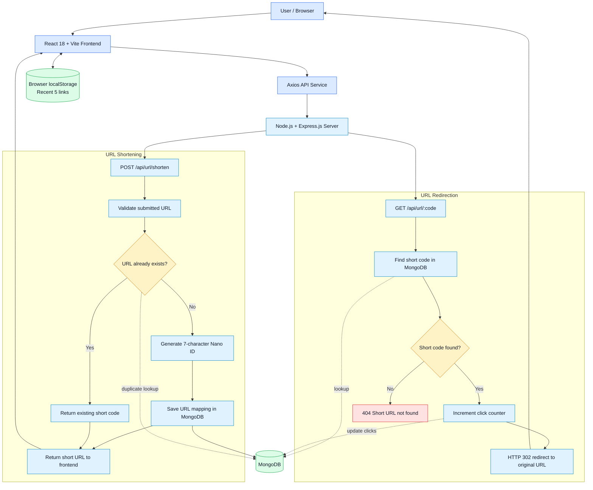
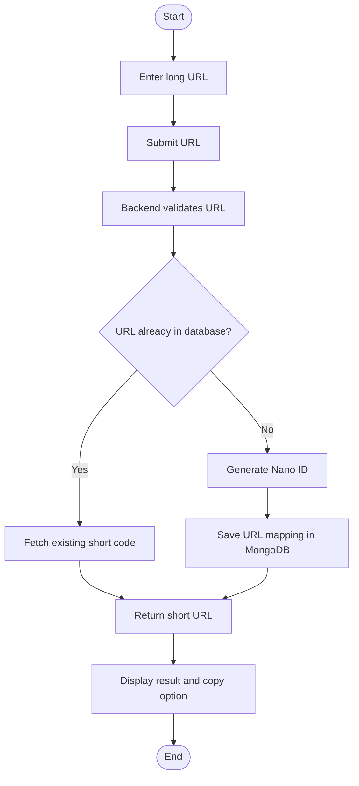
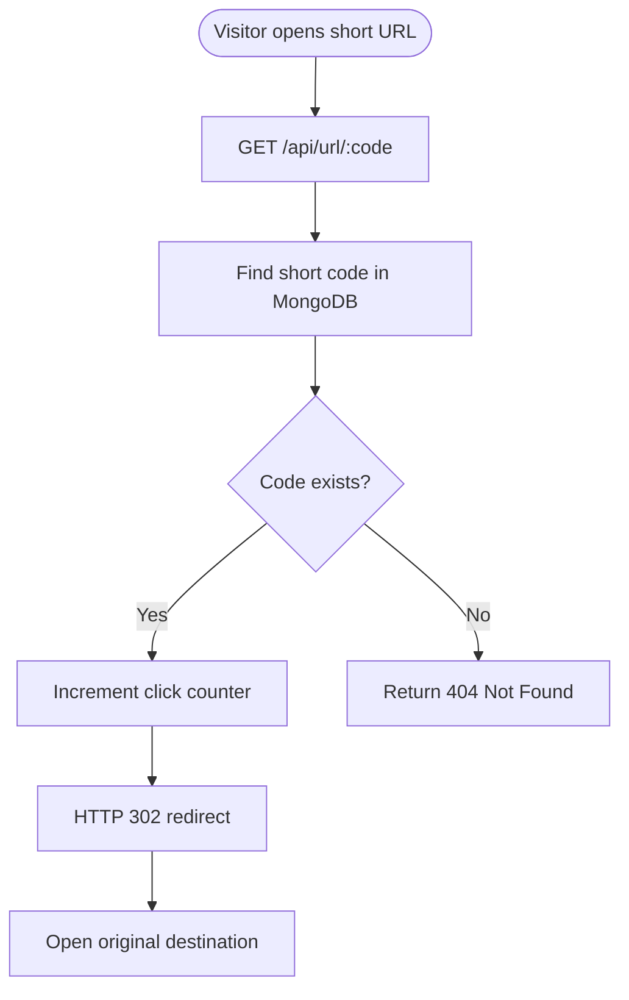

<!--
  SnipURL - Enhanced GitHub README
  Copy this entire file into README.md in your repository.
-->

<div align="center">

# 🔗 SnipURL
### Turn long URLs into short, clean, shareable links.

**A full-stack URL shortener built with the MERN stack.**

<p>
  <a href="https://snip-url-green.vercel.app/">🌐 Live Demo</a> •
  <a href="https://github.com/anuj-yd/SnipURL">📂 Source Code</a>
</p>


</div>

---

## 📌 Table of Contents

- [✨ Overview](#-overview)
- [🚀 Live Application](#-live-application)
- [⭐ Features](#-features)
- [🧰 Technology Stack](#-technology-stack)
- [🏗️ System Architecture](#️-system-architecture)
- [🔄 How It Works](#-how-it-works)
- [📁 Project Structure](#-project-structure)
- [⚙️ Getting Started](#️-getting-started)
- [🔌 API Reference](#-api-reference)
- [🗄️ Data Model](#️-data-model)
- [🌍 Deployment](#-deployment)
- [🔮 Future Enhancements](#-future-enhancements)
- [📚 Key Learnings](#-key-learnings)
- [🤝 Contributing](#-contributing)
- [👨‍💻 Author](#-author)
- [📄 License](#-license)

---

## ✨ Overview

**SnipURL** is a full-stack URL shortening application that transforms long web addresses into compact, easy-to-share links. It is built using **MongoDB, Express.js, React.js, and Node.js**.

The application provides a simple interface where a user can submit a valid URL and receive a shorter link. When the generated link is opened, the backend finds the original destination, updates its click count, and redirects the visitor.

SnipURL also checks whether a URL has already been shortened. Instead of creating another record for a duplicate URL, it can return the existing short link. Recently generated links are retained in the browser using `localStorage`.

### 🎯 Project Goal

To build a practical full-stack application that demonstrates REST API development, database integration, short-code generation, HTTP redirection, click tracking, and responsive frontend development.

---

## 🚀 Live Application

| Resource | Link |
|---|---|
| **Live Demo** | https://snip-url-green.vercel.app/ |
| **GitHub Repository** | https://github.com/anuj-yd/SnipURL |

> Open the live application, enter a valid `https://` or `http://` address, and generate a shareable short link.

---

## ⭐ Features

| Feature | Description |
|---|---|
| 🔗 **URL Shortening** | Converts valid long URLs into compact, shareable links. |
| 🆔 **Unique Short Codes** | Uses Nano ID to generate 7-character alphanumeric short codes. |
| ♻️ **Duplicate Detection** | Checks whether the submitted long URL already exists and reuses its short code. |
| ↪️ **Automatic Redirection** | Redirects visitors to the original URL using an HTTP 302 response. |
| 📈 **Click Tracking** | Increments the click counter whenever a short link is accessed. |
| 📋 **Copy to Clipboard** | Lets users copy a generated short link with visual feedback. |
| 🕘 **Recent Links** | Keeps the five most recently generated links in browser `localStorage`. |
| ⏳ **Loading States** | Displays a loading indicator while API requests are being processed. |
| 🚫 **404 Handling** | Returns a not-found response when an unknown short code is requested. |
| 📱 **Responsive UI** | Provides a mobile-first interface for desktop, tablet, and mobile screens. |

---

## 🧰 Technology Stack

| Layer | Technology | Purpose |
|---|---|---|
| Frontend | React 18 | Component-based user interface |
| Build Tool | Vite | Frontend development and build tooling |
| Routing | React Router v6 | Client-side navigation |
| Styling | Tailwind CSS v3 | Responsive UI styling |
| Typography | Google Fonts – Inter | Interface typography |
| HTTP Client | Axios | Frontend-to-backend API communication |
| Backend Runtime | Node.js | Server-side JavaScript runtime |
| Backend Framework | Express.js | REST API and request handling |
| Database | MongoDB | Persistent URL mapping storage |
| ODM | Mongoose | MongoDB schema and data operations |
| Short Code | Nano ID | Generation of compact, 7-character identifiers |
| Browser Storage | localStorage | Stores recent links in the user's browser |
| Development | npm, Nodemon | Package management and backend development |

---

## 🏗️ System Architecture

SnipURL follows a simple client-server architecture. The React frontend communicates with the Express.js backend through REST endpoints. MongoDB stores the original URLs, generated short codes, and click information. The browser's `localStorage` is used for the recent-links experience.

### Architecture Diagram



### Main Components

- **Frontend:** Collects the long URL, displays the generated short link, provides copy feedback, and shows recent links.
- **API Layer:** Handles URL creation, duplicate checks, short-code lookup, click-count updates, and redirects.
- **MongoDB:** Persists the mapping between a short code and its original URL.
- **Browser Storage:** Retains the five most recently generated links on the client side.

> **Implementation note:** The current project uses Nano ID for short-code generation and MongoDB for URL lookups. Redis caching and Base62 ID conversion are possible future improvements; they are not represented as currently implemented features in this architecture.

---

## 🔄 How It Works

### 1. URL Shortening Workflow

1. The user enters a long URL in the React interface.
2. The frontend sends the URL to `POST /api/url/shorten` through Axios.
3. The backend validates the submitted URL.
4. The backend checks MongoDB to determine whether the URL has already been shortened.
5. If the URL exists, the existing short code is returned.
6. If it is new, the backend generates a 7-character Nano ID and saves the URL mapping in MongoDB.
7. The API returns the short URL and related link details to the frontend.
8. The UI displays the result and provides a copy-to-clipboard action.

### URL Shortening Flow



### 2. URL Redirection and Click Tracking Workflow

1. A visitor opens a generated short link.
2. The request reaches `GET /api/url/:code`.
3. The backend searches MongoDB using the supplied short code.
4. If the code exists, the click counter is incremented.
5. The server responds with an HTTP `302` redirect to the original URL.
6. If the code does not exist, the API returns a `404 Not Found` response.

### Redirection Flow



---

## 📁 Project Structure

```text
SnipURL/
│
├── backend/
│   ├── config/
│   │   └── db.js                  # MongoDB connection configuration
│   │
│   ├── controllers/
│   │   └── urlController.js       # URL shortening and redirect logic
│   │
│   ├── models/
│   │   └── Url.js                 # Mongoose URL model
│   │
│   ├── routes/
│   │   └── urlRoutes.js           # URL API routes
│   │
│   ├── .env                       # Local environment variables (create locally)
│   ├── server.js                  # Express server entry point
│   └── package.json               # Backend dependencies and scripts
│
├── frontend/
│   ├── src/
│   │   ├── components/
│   │   │   ├── UrlForm.jsx        # Long URL input form
│   │   │   ├── ShortUrlResult.jsx # Generated short URL and copy action
│   │   │   └── RecentLinks.jsx    # Recent links interface
│   │   │
│   │   ├── pages/
│   │   │   ├── Home.jsx           # Main application page
│   │   │   └── RedirectHandler.jsx# Short-link route handling
│   │   │
│   │   ├── services/
│   │   │   └── api.js             # Axios API configuration and calls
│   │   │
│   │   ├── App.jsx                # Application routes and layout
│   │   ├── main.jsx               # React application entry point
│   │   └── index.css              # Global styles and Tailwind directives
│   │
│   ├── index.html
│   ├── tailwind.config.js
│   ├── postcss.config.js
│   ├── vite.config.js
│   └── package.json
│
├── .gitignore
├── CONTRIBUTORS.md
├── render.yaml                    # Render deployment configuration
└── README.md
```

---

## ⚙️ Getting Started

Follow these steps to run SnipURL locally.

### ✅ Prerequisites

Make sure the following tools are installed:

- [Node.js](https://nodejs.org/) – version 18 or later recommended
- npm – included with Node.js
- [MongoDB Community Server](https://www.mongodb.com/try/download/community) or a [MongoDB Atlas](https://www.mongodb.com/atlas) database
- [Git](https://git-scm.com/)

### 1️⃣ Clone the Repository

```bash
git clone https://github.com/anuj-yd/SnipURL.git
cd SnipURL
```

### 2️⃣ Configure and Run the Backend

Open a terminal in the project root and run:

```bash
cd backend
npm install
```

Create a `.env` file inside the `backend` directory:

```env
PORT=5000
MONGO_URI=mongodb://localhost:27017/urlshortener
BASE_URL=http://localhost:5000
```

**Environment variable details:**

| Variable | Description | Local Example |
|---|---|---|
| `PORT` | Port on which the Express server runs | `5000` |
| `MONGO_URI` | MongoDB connection string | `mongodb://localhost:27017/urlshortener` |
| `BASE_URL` | Base address used to construct short links | `http://localhost:5000` |

Start the backend:

```bash
# Development mode
npm run dev

# Production mode
npm start
```

The backend should be available at:

```text
http://localhost:5000
```

> Use the script supported by the backend `package.json`. If `npm run dev` is unavailable, check the available scripts or use the configured start command.

### 3️⃣ Configure and Run the Frontend

Open a **second terminal** from the project root:

```bash
cd frontend
npm install
npm run dev
```

Vite will show the local frontend address in the terminal. It is commonly:

```text
http://localhost:5173
```

Open that address in your browser and test the application.

> Ensure the frontend API configuration points to the backend URL and port you are running locally. Check `frontend/src/services/api.js` if you need to update it.

---

## 🔌 API Reference

The backend exposes the following primary endpoints.

### 1. Shorten a URL

| Property | Value |
|---|---|
| Method | `POST` |
| Endpoint | `/api/url/shorten` |
| Purpose | Creates a short link for a valid long URL |

**Request body**

```json
{
  "longUrl": "https://example.com/very/long/path"
}
```

**Example success response**

```json
{
  "shortUrl": "http://localhost:5000/api/url/aB3dE7f",
  "shortCode": "aB3dE7f",
  "longUrl": "https://example.com/very/long/path",
  "clicks": 0,
  "createdAt": "2026-11-03T10:00:00.000Z"
}
```

> The response above illustrates the documented response shape. Confirm the exact status code and fields against the current controller if you change the implementation.

### 2. Redirect Using a Short Code

| Property | Value |
|---|---|
| Method | `GET` |
| Endpoint | `/api/url/:code` |
| Purpose | Finds the original URL, updates click count, and redirects the visitor |

**Example request**

```http
GET /api/url/aB3dE7f
```

**Expected outcomes**

| Status | Meaning |
|---|---|
| `302` | Redirects to the original URL |
| `404` | The requested short code does not exist |
| `500` | An unexpected server error occurred |

**Example not-found response**

```json
{
  "error": "Short URL not found."
}
```

---

## 🗄️ Data Model

The URL model stores the relationship between a generated short code and its original destination.

| Field | Description |
|---|---|
| `_id` | MongoDB document identifier |
| `longUrl` | Original destination URL |
| `shortCode` | Generated 7-character Nano ID |
| `clicks` | Number of times the short link has been accessed |
| `createdAt` | Date and time when the record was created |

**Conceptual document example**

```json
{
  "_id": "MongoDB-generated-id",
  "longUrl": "https://example.com/very/long/path",
  "shortCode": "aB3dE7f",
  "clicks": 0,
  "createdAt": "2026-11-03T10:00:00.000Z"
}
```

The exact field configuration and timestamp behavior are defined in `backend/models/Url.js`.

---

## 🌍 Deployment

The application can be deployed using separate hosting services for the frontend, backend, and database.

| Component | Suggested Platform |
|---|---|
| Frontend | [Vercel](https://vercel.com/) or [Netlify](https://www.netlify.com/) |
| Backend | [Render](https://render.com/) or [Railway](https://railway.com/) |
| Database | [MongoDB Atlas](https://www.mongodb.com/atlas) |

### Deployment Checklist

1. Create a production database in MongoDB Atlas.
2. Add the production `MONGO_URI`, `PORT`, and `BASE_URL` to the backend hosting provider's environment settings.
3. Set `BASE_URL` to the deployed backend's public URL so generated short links point to the correct server.
4. Configure the frontend API base URL to use the deployed backend.
5. Configure backend CORS to allow requests from the deployed frontend domain.
6. Deploy both applications and test URL creation, duplicate detection, redirection, and click tracking.
7. Confirm that the frontend's client-side routes work correctly after deployment.

**Example CORS configuration** — adapt the allowed origin to your deployed frontend domain and the existing `server.js` setup:

```js
app.use(cors({
  origin: "https://your-frontend-domain.com"
}));
```

---

## 🔮 Future Enhancements

The following ideas can extend SnipURL beyond its current functionality:

- 🔐 **User Authentication:** Add JWT-based authentication and user-specific link management.
- 📊 **Analytics Dashboard:** Display click counts, traffic trends, and link performance.
- ⚡ **Redis Caching:** Cache frequently requested short-code mappings to reduce repeated database reads.
- 🔢 **Base62 Encoding:** Explore converting unique numeric IDs into compact Base62 codes instead of using Nano ID.
- ✏️ **Custom Aliases:** Allow users to create memorable short codes.
- ⏰ **Link Expiration:** Support automatic expiry of short links.
- 🛡️ **Rate Limiting:** Protect endpoints against excessive requests and abuse.
- 📱 **QR Code Generation:** Generate downloadable QR codes for short links.
- 🗂️ **URL Management:** Allow authenticated users to view, organize, update, and delete their links.
- 🐳 **Docker Support:** Containerize the frontend and backend for consistent development and deployment.

---

## 📚 Key Learnings

Building SnipURL offers hands-on experience with:

- Developing and integrating a full-stack MERN application.
- Designing RESTful API endpoints and connecting frontend components to backend services.
- Structuring backend code using routes, controllers, models, and configuration modules.
- Working with MongoDB and Mongoose for persistent data storage.
- Generating compact identifiers using Nano ID.
- Understanding HTTP status codes and redirect behavior, especially HTTP 302.
- Implementing duplicate detection and click tracking.
- Managing asynchronous API requests and UI loading/error states.
- Using browser `localStorage` to preserve recent links.
- Building responsive interfaces with React and Tailwind CSS.

---

## 🤝 Contributing

Contributions, suggestions, and bug reports are welcome!

1. Fork the repository.
2. Create a feature branch: `git checkout -b feature/your-feature-name`.
3. Commit your changes: `git commit -m "Add: your feature description"`.
4. Push the branch: `git push origin feature/your-feature-name`.
5. Open a Pull Request describing your changes.

Please keep pull requests focused and include clear steps to reproduce bug fixes where applicable.

---

## 👨‍💻 Author

**Anuj Kumar Yadav**  
B.Tech – Computer Science and Engineering  
Lovely Professional University

- **GitHub:** [anuj-yd](https://github.com/anuj-yd)
- **Project:** [SnipURL Repository](https://github.com/anuj-yd/SnipURL)
- **Live Demo:** [SnipURL](https://snip-url-green.vercel.app/)

---

## 📄 License

This project is licensed under the **MIT License**. See the `LICENSE` file in the repository for details.

---

<div align="center">

### ⭐ If you find SnipURL useful, consider giving the repository a star!

**Built with ❤️ using the MERN Stack**

</div>
